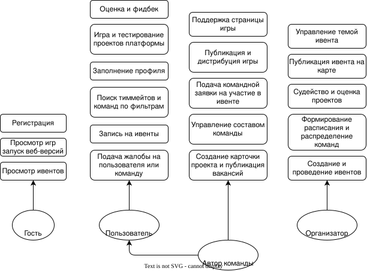
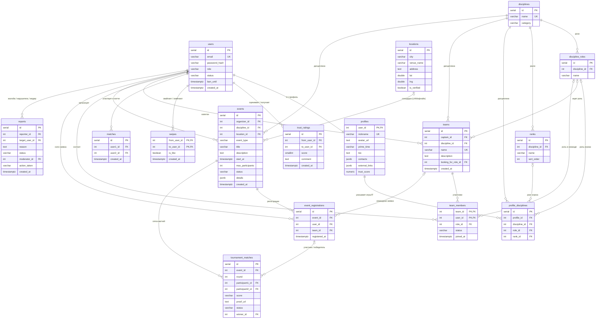

# MatchPoint

# Состав команды

### Солома Максим — YbGHFBK

### Карулис Иван — Karulis1

### Нарожник Александр — Hikonodere

### Терёхин Кирилл — VeRfetti

# Сценарии использования по ролям

## Гость

1. Регистрация / Авторизация
2. Просмотр витрины игр и запуск веб-версий
3. Просмотр открытых ивентов

## Пользователь

1. Заполнение профиля и интеграция портфолио (GitHub, GitLab, Pet-проекты, стек технологий, грейд)
2. Поиск тиммейтов и команд по фильтрам (стек, роль, часовой пояс, цель)
3. Отклик на объявление о наборе в проект или команду на ивент
4. Запись на ивенты
5. Подача жалобы на пользователя или команду
6. Игра и тестирование проектов платформы
7. Оценка и фидбек

## Автор команды _(наследует права пользователя)_

1. Создание карточки проекта и публикация вакансий под конкретные роли/стек
2. Управление составом команды (прием заявок, приглашение участников, распределение задач, исключение)
3. Подача командной заявки на участие в ивенте
4. Публикация и дистрибуция игры
5. Поддержка страницы игры

## Организатор

1. Создание и проведение ивентов
2. Формирование расписания и распределение команд по менторам
3. Судейство и оценка проектов по заданным критериям
4. Публикация ивента на карте
5. Управление темой ивента

## Модератор

1. Обработка жалоб пользователей (Reports Queue)
2. Модерация публичного контента
3. Выдача предупреждений и временных ограничений (Warn/Mute/Temp Ban)

## Администратор системы

1. Управление аккаунтами и правами (Назначение ролей)
2. Полная блокировка пользователей / IP (Permanent Ban)
3. Управление справочниками платформы (технологические стеки, роли, теги направлений)
4. Просмотр системной аналитики, метрик активности и логов аудита
5. Верификация компаний-партнеров, спонсоров и аккредитация организаторов



# MatchPoint — Техническая спецификация и план разработки

**MatchPoint** — это веб-платформа для быстрого поиска тиммейтов в игры и IT-проекты с помощью механики свайпов, а также площадка для организации и участия в мероприятиях (киберспортивные турниры, LAN-ивенты, Watch Party, хакатоны и соревнования по программированию).

---

## 1. Стек технологий и обязательные требования

* **Frontend:** HTML5, CSS3, Vanilla JavaScript (ES6+).
* **Адаптивность (`@media`):** полноценная поддержка мобильных устройств (`360px–767px`), планшетов (`768px–1023px`) и десктопов (`1024px+`).
* **Клиентские хранилища:**
  * `localStorage` — хранение токена авторизации (JWT/сессии), выбранной темы оформления, сохранённых фильтров поиска тиммейтов.
  * `sessionStorage` — сохранение черновиков форм (создание ивента, объявления в команду, редактирование профиля) и временной истории просмотренных карточек в рамках текущей сессии.
* **Backend:** Node.js + Express (минималистичный REST API + раздача статики).
* **База данных:** SQLite (для быстрого локального старта) с возможностью миграции на PostgreSQL (использование стандартного SQL).

---

## 2. Ключевые модули системы

1. **Авторизация, роли и профили:**
   * Ролевая модель: *Гость, Игрок, Капитан, Организатор/Судья, Модератор, Администратор*.
   * Анкета пользователя: игры/IT-направления, роли, рейтинг (MMR / уровень), прайм-тайм, ссылки на внешние профили (Steam, Faceit, GitHub).
   * Система репутации **Trust Factor** (оценка порядочности и коммуникации после совместных игр или ивентов).
2. **Подбор тиммейтов (Система свайпов):**
   * Лента карточек игроков и открытых вакансий команд.
   * Фильтрация по дисциплине, роли, уровню и прайм-тайму.
   * Свайпы (лайк/пропуск) через мышь, тач-жесты или кнопки.
   * Взаимный лайк (Match) открывает доступ к контактам или простому лобби-чату.
3. **Управление командами (Капитан):**
   * Создание команды, публикация объявлений о поиске игрока на конкретную роль, принятие и исключение участников.
   * Подача командных заявок на турниры и хакатоны.
4. **Отдельная логика мероприятий (Ивенты и Турниры):**
   * Разделение на два типа с разными атрибутами и сценариями:
     * **Киберспорт (Турниры / LAN / Watch Party):** дисциплина, формат (например, 5x5), турнирная сетка, загрузка скриншотов результатов капитанами, арбитраж спорных матчей судьёй.
     * **IT-мероприятия (Хакатоны / Турниры по программированию):** стек технологий, треки/номинации, лимит участников в команде, дедлайн сдачи решения и ссылка на репозиторий.
   * Открытый каталог и карта/список локаций (доступны даже Гостю).
5. **Модерация и Админ-панель:**
   * Очередь жалоб (Reports Queue), модерация контента, выдача предупреждений, мутов и временных банов.
   * Панель администратора: управление ролями, перманентные баны, верификация организаторов, управление справочниками (игры, ранги, роли, локации), базовая аналитика и логи.

---

## 3. Структура проекта

```text
matchpoint/
├── client/                  # Фронтенд (HTML, CSS, JS)
│   ├── css/
│   │   ├── main.css         # Общие стили, переменные, сброс
│   │   ├── media.css        # @media-запросы для адаптивности
│   │   └── pages/           # Стили конкретных страниц (swipe.css, events.css и т.д.)
│   ├── js/
│   │   ├── api.js           # Обёртка для fetch-запросов к бэкенду
│   │   ├── storage.js       # Работа с localStorage и sessionStorage
│   │   ├── auth.js          # Логика входа/регистрации
│   │   ├── swipe.js         # Движок карточек и свайпов
│   │   ├── events.js        # Логика турниров и хакатонов
│   │   └── admin.js         # Логика модерации и админки
│   ├── index.html           # Главная / Лента свайпов
│   ├── events.html          # Каталог ивентов и карта
│   ├── teams.html           # Команды и управление составом
│   ├── profile.html         # Профиль пользователя и Trust Factor
│   └── admin.html           # Панель модератора и администратора
├── server/                  # Бэкенд (Node.js + Express)
│   ├── db/
│   │   ├── schema.sql       # Таблицы БД
│   │   ├── seed.sql         # Тестовые данные (пользователи, ивенты, справочники)
│   │   └── database.js      # Подключение к SQLite / PostgreSQL
│   ├── middleware/
│   │   └── auth.js          # Проверка токена и прав доступа по ролям
│   ├── routes/
│   │   ├── auth.js          # /api/auth/*
│   │   ├── profile.js       # /api/profile/*
│   │   ├── swipes.js        # /api/cards, /api/swipe, /api/matches
│   │   ├── teams.js         # /api/teams/*
│   │   ├── events.js        # /api/events/*
│   │   └── admin.js         # /api/reports/*, /api/admin/*
│   └── server.js            # Точка входа сервера
├── package.json
└── README.md
```

---

## 4. Минимальный REST API

| Группа | Метод и эндпоинт | Описание |
| :--- | :--- | :--- |
| **Auth** | `POST /api/auth/register` | Регистрация нового пользователя |
| **Auth** | `POST /api/auth/login` | Авторизация, выдача токена и роли |
| **Profile** | `GET /api/profile/:id` | Получение анкеты и Trust Factor |
| **Profile** | `PUT /api/profile` | Обновление анкеты и ссылок (Steam/Faceit/GitHub) |
| **Swipe** | `GET /api/cards` | Выдача анкет/команд по фильтрам |
| **Swipe** | `POST /api/swipe` | Отправка лайка или пропуска, проверка мэтча |
| **Swipe** | `GET /api/matches` | Список взаимных мэтчей пользователя |
| **Teams** | `POST /api/teams` | Создание команды (Капитан) |
| **Teams** | `PATCH /api/teams/:id/members` | Принятие/исключение игрока из состава |
| **Events** | `GET /api/events` | Каталог ивентов (фильтр: турниры / хакатоны / LAN) |
| **Events** | `POST /api/events` | Создание мероприятия (Организатор) |
| **Events** | `POST /api/events/:id/register` | Запись соло или командой на ивент |
| **Events** | `POST /api/events/:id/result` | Загрузка результата/скриншота и арбитраж |
| **Mod/Admin** | `POST /api/reports` | Отправка жалобы на игрока или контент |
| **Mod/Admin** | `GET /api/reports` | Очередь жалоб (Модератор) |
| **Mod/Admin** | `PATCH /api/admin/users/:id` | Смена роли, мут или бан (Модератор/Админ) |
| **Mod/Admin** | `GET/POST /api/admin/dictionaries` | Управление справочниками (игры, роли, ранги, локации) |

---

## 5. Распределение задач по участникам команды

> *Примечание: роли распределены равномерно по 4 направлениям. При необходимости участники могут обменяться зонами ответственности до старта Этапа 1.*

### 1.Нарожник — Бэкенд, Архитектура и База данных
**Зона ответственности:** серверная часть на Node.js, проектирование БД, безопасность, ролевая модель и наполнение тестовыми данными.

* [ ] Инициализировать проект (`package.json`, Express, CORS, подключение SQLite/PostgreSQL), настроить структуру папок и ветки Git (`main`, `dev`).
* [ ] Спроектировать и написать `schema.sql` со всеми таблицами: `users`, `profiles`, `swipes`, `matches`, `teams`, `team_members`, `events`, `event_registrations`, `match_results`, `reports`, `dictionaries`.
* [ ] Реализовать авторизацию (`/api/auth/register`, `/api/auth/login`) с хэшированием паролей.
* [ ] Написать middleware для проверки авторизации и разграничения прав доступа по всем 6 ролям (Гость, Игрок, Капитан, Организатор, Модератор, Админ).
* [ ] Подготовить скрипт `seed.sql` с реалистичными данными (15–20 анкет, справочники игр/IT-стеков/рангов, тестовые аккаунты для каждой роли).
* [ ] Настроить базовое логирование действий администраторов и ошибок сервера.

---

### 2.Терёхин — Фронтенд (Ядро): Система свайпов, Стили и Адаптивность
**Зона ответственности:** главный экран, механика свайпов, клиентские хранилища (`localStorage` / `sessionStorage`) и адаптивная вёрстка (`@media`).

* [ ] Разработать единую дизайн-систему (`main.css`): цветовая палитра, типографика, кнопки, модальные окна, шапка сайта с адаптивным бургер-меню.
* [ ] Настроить `media.css` с `@media`-запросами для корректного отображения всех страниц на смартфонах, планшетах и десктопах.
* [ ] Написать модуль `storage.js`:
  * сохранение токена, темы и фильтров подбора в `localStorage`;
  * сохранение черновиков форм и истории просмотренных карточек текущей сессии в `sessionStorage`.
* [ ] Сверстать и запрограммировать ленту свайпов (`index.html`, `swipe.js`): перетаскивание карточек мышкой/тачем, кнопки «Лайк / Пропуск», плавные CSS-анимации.
* [ ] Реализовать панель фильтров (игра/направление, роль, MMR/уровень, прайм-тайм) и подключение к `GET /api/cards` и `POST /api/swipe`.
* [ ] Сделать модальное окно «It’s a Match!» и список взаимных совпадений (`GET /api/matches`) с отображением контактов/чата.

---

### 3. Fullstack: Отдельная логика ивентов и Команды
**Зона ответственности:** модуль мероприятий (турниры + хакатоны), карта/локации, функционал Капитана и Организатора/Судьи.

* [ ] Реализовать бэкенд-роуты для команд (`server/routes/teams.js`) и мероприятий (`server/routes/events.js`).
* [ ] Продумать и реализовать **отдельную логику ивентов**:
  * переключение/фильтрация между киберспортивными турнирами (LAN, Watch Party, онлайн-сетка) и IT-мероприятиями (хакатоны, турниры по проге);
  * разные формы создания и карточки отображения для этих двух типов.
* [ ] Сверстать страницу ивентов (`events.html`), доступную в том числе Гостю, с каталогом и интерактивным блоком локаций/картой (например, на базе Leaflet.js или интерактивного списка площадок).
* [ ] Реализовать интерфейс Организатора/Судьи: создание ивента, простая турнирная сетка, арбитраж спорных матчей (просмотр загруженных скриншотов и подтверждение победителя).
* [ ] Сверстать страницу команд (`teams.html`) с функционалом Капитана: создание команды, публикация вакансии на роль, принятие/исключение игроков, подача заявки команды на ивент и загрузка результатов матча.

---

### 4. Fullstack: Профили, Trust Factor, Модерация, Админка и QA
**Зона ответственности:** личный кабинет, система репутации, панели Модератора и Администратора, финальное тестирование.

* [ ] Реализовать бэкенд-роуты для профилей (`server/routes/profile.js`) и администрирования/жалоб (`server/routes/admin.js`).
* [ ] Сверстать страницу профиля (`profile.html`): редактирование анкеты, выбор игр/ролей из справочников, поля интеграции (Steam/Faceit/GitHub) с валидацией ссылок.
* [ ] Реализовать систему репутации **Trust Factor** (форма оценки тиммейта после мэтча/ивента и отображение рейтинга порядочности в профиле и карточке свайпа) + кнопку «Пожаловаться (Report)».
* [ ] Сверстать панель Модератора (`admin.html` — вкладка модерации): очередь жалоб (`Reports Queue`), просмотр контента, кнопки выдачи Warn / Mute / Temp Ban.
* [ ] Сверстать панель Администратора (`admin.html` — вкладка админа): таблица пользователей со сменой ролей и перманентным баном, верификация организаторов, управление справочниками (игры, ранги, роли, локации) и блок базовой аналитики.
* [ ] Провести сквозное тестирование всех ролей (от Гостя до Админа), проверить адаптивность на разных экранах и обновить итоговый `README.md` с инструкцией по запуску.

---

## 6. Этапы разработки (Roadmap)

1. **Этап 1 (Фундамент):** структура репозитория, `schema.sql`, запуск Express-сервера, базовый `main.css` и `storage.js`.
2. **Этап 2 (Вход и профили):** регистрация/авторизация, ролевой middleware, личный кабинет, сохранение сессии в `localStorage`.
3. **Этап 3 (Ядро — Свайпы):** лента карточек, фильтры, свайпы, мэтчи, адаптив под мобилки.
4. **Этап 4 (Ивенты и Команды):** отдельная логика турниров и хакатонов, карта/каталог, функционал Капитана и Организатора.
5. **Этап 5 (Контроль и репутация):** Trust Factor, жалобы, панель Модератора и Админ-панель.
6. **Этап 6 (Полировка и демо):** наполнение БД тестовыми данными, проверка `@media`-запросов, багфикс и подготовка к защите.

---

## 7. Правила работы с Git (для реалистичной истории разработки)

* Основная ветка — `main` (только рабочий код).
* Ветка разработки — `dev` (сюда сливаются готовые фичи через Pull Request).
* Каждая задача делается в отдельной ветке: `feature/auth`, `feature/swipe-ui`, `feature/events-logic`, `feature/admin-panel`.
* Понятные префиксы коммитов: `feat:` (новая фича), `fix:` (исправление), `style:` (верстка/CSS), `docs:` (документация).
